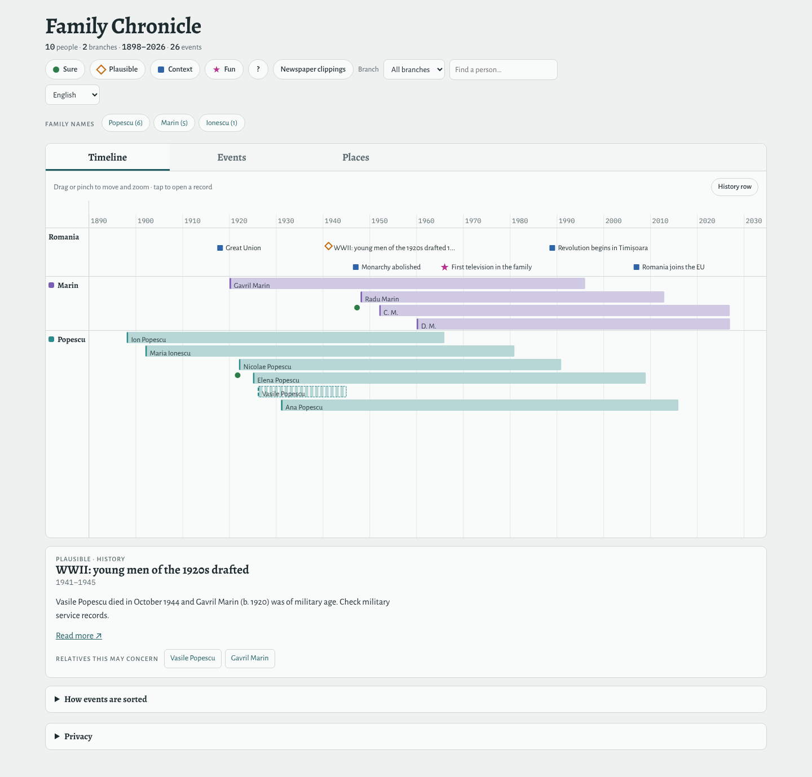

# Family Chronicle

Turns a GEDCOM family tree export into a single HTML page with a zoomable timeline and a linked globe map.



*The demo tree (`npm run dev:demo`).*

- One timeline row per family branch, plus a history row
- Lifespans as bars; hatched when a date is estimated
- Four event categories, shown by colour and shape:
  - **Sure** (green circle): dated facts from the tree
  - **Plausible** (orange diamond): estimated dates, or history that likely touched a named relative
  - **Context** (blue square): history of the time and place, no claimed personal link
  - **Fun** (magenta star): family stories, firsts and curiosities
- An events list under the timeline: sortable by date, filtered by name, place or year (diacritics optional), and by the same category and branch filters; a row opens its record
- The map shows only events in the years visible on the timeline, with migration lines between a person's places
- A "Family names" section: what each surname suggests, its origins, variations and changes over time, plus the spellings found in the tree
- A list of data problems found in the tree (possible duplicates, contradictions, missing dates, places without a map location)

## Project layout

```
index.html          page markup
src/                the app in TypeScript (no family data)
  main.ts             start-up: header, filters, search
  timeline.ts         vis-timeline rows and items
  globe.ts            D3 globe: canvas background, pins, migration lines
  card.tsx            record card (Preact) (person, event, place)
  events.tsx          events list (Preact): sort, text filter
  data.ts             loads the parsed tree, family links
  types.ts            shape of the parsed data
  style.css
scripts/
  parse-gedcom.ts     GEDCOM + config -> the data the app shows, and build/checks.txt (data problems, for you)
  family-data-plugin.ts  Vite plugin: picks the tree, parses it, adds the country outlines, hands it to the app
  check_no_family_data.sh  fails if a real tree or config is tracked by git (runs in CI)
public/             .htaccess and robots.txt, copied into dist/
demo/               fictional demo tree, committed
  dummy.ged           2 families, 10 people
  dummy.config.json   settings and history events for the demo
data/               your own tree, gitignored
  tree.ged            your GEDCOM export
  tree.config.json    settings for your tree (optional)
build/, dist/       generated, gitignored
```

## Requirements

- Node.js 20.19+ or 22.12+ (Vite 7 does not run on Node 21 or 22.0–22.11)

That's all: the GEDCOM parser is TypeScript and runs inside Vite, with no extra packages.

## Quick start (demo)

```bash
npm install
npm run dev
```

`npm run dev` parses the tree and opens a live-reloading page. Editing the `.ged` file or its config reloads the page too. Without `data/tree.ged`, it uses the demo tree in `demo/`.

To build the static site and look at it:

```bash
npm run build
npm run preview
```

The page is built as ES modules, so `dist/index.html` must be served over HTTP (`npm run preview` or any web server); opening the file directly from disk does not work.

## Use your own tree

Put your export at `data/tree.ged`. It replaces the demo automatically:

```bash
mkdir -p data
cp ~/Downloads/your-export.ged data/tree.ged
cp demo/dummy.config.json data/tree.config.json   # optional starting point, edit for your tree
npm run build
```

| Command | Does |
|---|---|
| `npm run dev` / `npm run build` | parse `data/tree.ged` if it exists, else `demo/dummy.ged`; then serve / build |
| `npm run dev:demo` / `npm run build:demo` | same, always with `demo/dummy.ged` |
| `GEDCOM=path/to/x.ged npm run build` | any file; config read from `path/to/x.config.json` |
| `npm run preview` | serve the built `dist/` locally |
| `npm run typecheck` | TypeScript check of the app and build scripts |

The parser prints which input and config it used, a summary of what it found and the privacy settings applied. The data checks, with full names, go to `build/checks.txt`.

`GEDCOM` can also go in a `.env.local` file (`GEDCOM=path/to/x.ged`), which works the same on Windows. A relative path is read from the project folder.

## How it works

| Step | File | Output |
|---|---|---|
| Parse GEDCOM + config: normalise dates and places, estimate missing years, assign branches, add history events, apply the privacy rules, run data checks | `scripts/parse-gedcom.ts` | (in memory), `build/checks.txt` |
| Pick the tree, run the parser, add the outlines of Romania and its neighbours, cut from Natural Earth (`world-atlas`), and hand everything to the app as `virtual:family-data` | `scripts/family-data-plugin.ts` | (in the bundle) |
| Bundle the app, libraries, fonts and world maps; compile the Preact JSX (`@preact/preset-vite`) | Vite | `dist/` |

Everything is bundled: [vis-timeline](https://visjs.github.io/vis-timeline/), [D3](https://d3js.org/), [Preact](https://preactjs.com/) (the record card), the fonts (Fontsource) and the world maps. The page makes no requests to other sites, so it works offline and leaks nothing to CDNs. The detailed world maps are separate files, loaded only when you zoom in on the globe.

## Libraries

| Package | Version | Used for |
|---|---|---|
| `vite` | ^7.3.7 | dev server and build; needs Node `^20.19.0 \|\| >=22.12.0` |
| `@preact/preset-vite` | 2.10.6 | JSX compile and hot reload for Preact; supports Vite 2–8 |
| `preact` | 11.2.0 | record card (`src/card.tsx`) |
| `vis-timeline` | ^7.7.4 | timeline; the `standalone` build is used, so its peer packages are bundled in |
| `d3` | 7.9.0 | globe projection, pins and migration lines |
| `topojson-client`, `world-atlas` | 3.1.0, 2.0.2 | country and land outlines |
| `typescript` | 5.9.3 | type check only; Vite strips types when it builds |

The GEDCOM parser uses no library. Reading GEDCOM lines into a tree takes about 20 lines; the rest (dates, places, estimates, branches, checks) is specific to this project. It shares its output types with the app (`src/types.ts`), so `npm run typecheck` catches a mismatch between the two.

Only the record card uses Preact. The timeline and globe draw through vis-timeline and D3, so they stay plain TypeScript. JSX is set up in `tsconfig.json` (`"jsx": "react-jsx"`, `"jsxImportSource": "preact"`).

## Configuration

The code holds no family data. Everything specific to one tree goes in `<name>.config.json` next to the GEDCOM file. The file and every key in it are optional.

| Key | What it does |
|---|---|
| `settings.historyLabel` | Name of the history row (default `History`) |
| `settings.homeCountry` | Country highlighted on the globe (default `Romania`) |
| `settings.timelineStart` | First year shown (default: the decade before the earliest birth) |
| `settings.startEvent` | Title prefix of the event opened on load (default: first plausible history event) |
| `settings.livingYears` | People without a death record born within this many years count as living (default 100) |
| `settings.livingPeople` | How living people appear: `"full"` (default), `"initials"` or `"hidden"` ("Living person"). See [Privacy](#privacy) |
| `settings.causeOfDeath` | Show causes of death (default `false`) |
| `settings.checksOnPage` | Show "Things to fix" on the page (default `false`: they go to `build/checks.txt` only) |
| `places` | Place key → `label`, `lat`, `lon`, `approx` (approximate pin) |
| `placeRules` | `{contains, place}`: map messy place strings to a place key (`"Lisabona"` → `"Lisbon"`) |
| `branches` | Surname → branch name. Order sets branch colours |
| `noteEvents` | Facts from free-text notes or sources: `person`, `year`, `place`, `title`, `text`, optional `cat: "fun"` (shown as plausible, or as fun), `link` (source page, shown as "Read more"), `dated: true` (the year comes from a source, so it is shown without "c.") |
| `history` | Historical events: `cat` (`plausible`, `context` or `fun`), `start`, `end`, `place`, `title`, `text`, `link`, `people` |
| `surnames` | Family name → `meaning`, `origin`, `variants` (other spellings, also matched in the tree), `changes` (`when`, `text`), `link` |
| `placeNotes` | Extra "things to fix" lines: `text`, added when a raw place contains all strings in `rawPlaceContains` |

Example:

```json
{
  "settings": { "historyLabel": "Romania", "startEvent": "WWII" },
  "places": { "Craiova": { "label": "Craiova, Dolj", "lat": 44.32, "lon": 23.80, "approx": false } },
  "placeRules": [ { "contains": "Lisabona", "place": "Lisbon" } ],
  "branches": { "popescu": "Popescu", "ionescu": "Popescu" },
  "history": [
    { "cat": "plausible", "start": 1941, "end": 1945, "title": "WWII draft",
      "text": "Check military records.", "link": "https://en.wikipedia.org/wiki/Romania_in_World_War_II",
      "people": ["I5"] }
  ]
}
```

Notes:

- **Places.** A place can also carry its coordinates inside the GEDCOM file, with the standard `PLAC` › `MAP` › `LATI`/`LONG` tags. The demo does this. Place names with no location are listed in `build/checks.txt`.
- **Branches.** Without `branches`, each person's branch is their birth surname. Spouses who married in (with a married name and no parents in the tree) join the married surname. With `branches`, surnames not in the map join a relative's branch, or `Other`.
- **History.** A `plausible` history event whose `people` aren't in the tree is shown as `context`.
- **Map.** To map a different country, change `COUNTRIES` (and `REGION`) in `scripts/family-data-plugin.ts` and set `settings.homeCountry`.

## Newspaper clippings

Scanned newspaper pages can sit next to the tree in `<tree folder>/clippings/` (for `data/tree.ged`, that is `data/clippings/`), named `<document>_p<page>.jpg` after the Arcanum viewer address `adt.arcanum.com/en/view/<document>/?pg=<page>`. A `noteEvents` entry whose `link` or `text` contains such an address gets a thumbnail of the page in the person's record; clicking it opens a full-screen viewer (Prev/Next or arrow keys, click the page for full size, Esc to close). The header button "Newspaper clippings" opens the viewer at the oldest one.

Only the pages an event links to are served by `npm run dev` and copied to `dist/clippings/` by `npm run build`. Like the rest of `data/`, the folder is ignored by git. Scans from a subscription archive are under copyright: keep a page that shows them behind a password.

## Searching the Romanian National Archives

`npm run archives` (or `node scripts/search-archives.ts <tree.ged>`) searches the Romanian National Archives portal, [descopera.arhivelenationale.ro](https://descopera.arhivelenationale.ro/), for the people in the tree. It needs Node 22.18 or newer, which runs TypeScript directly.

It searches each surname (and its `variants` from the config), each surname with each village from the tree, each given name with the surname, and, for surnames of people born before about 1935, each surname with each year from 1860 to 1930. Only these names, villages and years are sent to the portal.

The portal returns catalogue entries (school files, petitions, veterans' files, and so on) and, for the digitised civil registers, index lines such as `Lina Ion Staicu Fierăscu -Albeni 1896-11-27 N-1896-56`: child, father, grandfather, surname, village, date, `N`/`C`/`D` (birth, marriage, death) and act number. Registers become public after 100 years, so these lines stop around 1925. The script matches the lines to people by first name, surname and year (for undated people, a year range worked out from their relatives) and scores higher when the father's or spouse's name matches the tree.

The results go to `build/archives.md`: possible matches by person, then all other register lines in date order (relatives, often the same village), then other catalogue entries. Nothing is added to the tree or the config automatically: check a match on the portal, then add it as a `noteEvents` entry with the `cota/?cid=` address as its `link`.

## Deploying

Upload the contents of `dist/` (including the hidden `.htaccess`). Asset URLs are relative, so any sub-folder works.

`.htaccess`, `robots.txt` and a `noindex` meta tag keep search engines out, but **anyone with the link can open the page**. To require a password on Apache, follow the steps in `public/.htaccess` (`htpasswd`, then uncomment four lines). Keep the `.htpasswd` file outside the web folder.

## Privacy

Everything the parser outputs for the page ends up in the page's JavaScript, readable by anyone who can open the page, even fields the page doesn't display. So the parser decides what gets in.

**Always:**
- Email addresses and long numbers (phone numbers, personal ID numbers such as the CNP) are removed from notes, occupations and education.
- GEDCOM fields the parser doesn't read (`EMAIL`, `ADDR`, `PHON`, sources, media) are never included.
- Place names exactly as typed in the tree stay out of the page; only places matched to a map location are used, and only those that something on the page points to.
- "Things to fix" (with full names, divorces, possible duplicates) goes to `build/checks.txt`, not the page, unless `settings.checksOnPage` is `true`.
- Causes of death are left out unless `settings.causeOfDeath` is `true`.

**People who may be living** (no death record, born within `livingYears`) are shown in full by default (`livingPeople: "full"`): by name, with places and notes; only their birth dates are cut to the year. **Before publishing a page that isn't behind a password, set `livingPeople` to `"initials"` or `"hidden"`.** Then they are:
- Shown by initials (`D. M.`); with `"hidden"`, as "Living person".
- Birth year only, no birth place, no notes, occupation or education.
- Marriages with a living spouse: year only, no place.
- `noteEvents` about them are left out (their titles and text name the person).
- A branch or family name carried only by living people is not shown.

Initials stop the page from being found by searching a name, but relatives can still be worked out from the people around them. Whichever setting you use, a page only for the family belongs behind a password.

**Not covered:** text you write yourself in the config (`history`, `surnames`, `noteEvents` about people who have died) is published as written, and street addresses inside free-text notes are not detected.

**In the repository:** `.gitignore` excludes `data/`, GEDCOM files in any letter case, every `*.config.json` except the demo's, `.htpasswd`, `build/` and `dist/`. `scripts/check_no_family_data.sh` fails CI if one of them is committed anyway; to run it before each commit too:

```bash
ln -s ../../scripts/check_no_family_data.sh .git/hooks/pre-commit
```

CI also builds the demo (which sets `livingPeople: "initials"`) and checks that its two living people don't appear in the output.

Keep the repository private, or publish only the code.

## Known limits

- Place coordinates are typed by hand; small villages are approximate.
- Historical events are a starting set, not research results. Each links to a source to check.
- Only `BIRT`, `DEAT`, `MARR`, `DIV`, `OCCU`, `EDUC`, `NOTE` and the "Death of Spouse" event are read so far.
- Dates must be plain (`12 FEB 1898`, `FEB 1898`, `1898`); qualifiers like `ABT` or `BET … AND …` aren't supported yet and stop the build.
